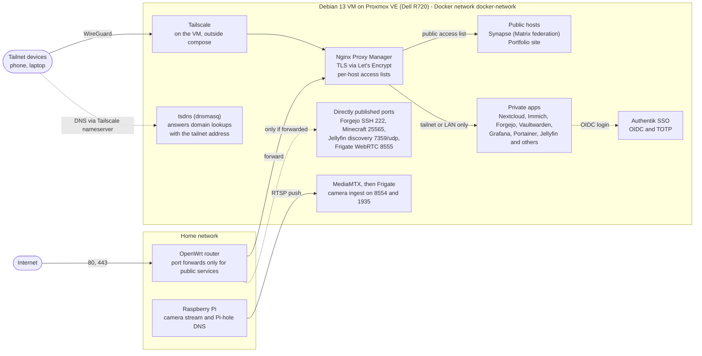

# Dell R720 homelab: self-hosted private cloud

A personal self-hosted stack on a single Dell PowerEdge R720 (Proxmox VE, Debian 13 VM): 38 Docker Compose services behind a reverse proxy, with single sign-on, VPN-only access to private tools, and monitoring with push alerts.

> **Scope:** this is a homelab on one physical host with no redundancy, not production infrastructure. Hostnames here are placeholders (`example.com`). Secrets live in a local `.env` that is never committed.

## What it runs

- **Personal cloud:** Nextcloud (files), Immich (photos), Forgejo (Git), Vaultwarden (passwords), Actual Budget, Excalidraw, Filebrowser
- **Media and messaging:** Jellyfin, Navidrome, Matrix (Synapse, federated), ntfy
- **Other:** SearXNG, a camera pipeline (MediaMTX and Frigate object detection), a portfolio site, a Minecraft server
- **Edge:** Nginx Proxy Manager terminates TLS (Let's Encrypt) and applies per-host access lists
- **Identity:** Authentik single sign-on (OIDC) with TOTP
- **Observability:** Prometheus (six scrape jobs) and Grafana covering the host, VM, containers and iDRAC hardware metrics; Uptime Kuma with 25 monitors provisioned by script; image-update notices (Diun) and alerts sent through a self-hosted ntfy server

## Architecture

The full service map, storage tiers and a per-service table are in [docs/architecture.md](docs/architecture.md).

## Repository contents

| File | Purpose |
|---|---|
| `docker-compose.yml` | The whole stack: 38 services on one private Docker network. Optional tooling sits behind a Compose profile. |
| `.env.example` | Every variable the stack needs: paths, image tags, credentials, OIDC client IDs. Copy it to `.env`. |
| `setup.sh` | One-time, re-runnable setup. Creates every folder the compose file mounts, refuses to run if the bulk-storage path is not a mounted drive (so data cannot silently land on the small disk), and writes the initial Postgres, Prometheus, Grafana, iDRAC exporter and Frigate configs. Existing files are kept. |
| `monitors.py` | Creates Uptime Kuma monitors through its API and adds only the ones that are missing. It patches the older API client at runtime to send the `conditions` field that Uptime Kuma 2.x requires. |
| `docs/architecture.md` | Service map, storage layout and component table. |

## Quick start

Requirements: a Linux host with Docker and Docker Compose, and a mounted drive for bulk data.

1. Copy `.env.example` to `.env` and fill it in. The comments explain how to generate the secret key and find the Docker group ID.
2. Run `bash setup.sh` to create the folders and starter configs.
3. Run `docker compose config -q` to validate the file.
4. Run `docker compose up -d`.
5. Create the Uptime Kuma admin account in its web UI (using the username and password from `.env`), then run `docker compose --profile tools run --rm kuma-monitors`.

The proxy hosts and access lists (Nginx Proxy Manager) and the SSO applications (Authentik) are configured in those tools' own data and are not part of this repository.

## Security model

- **Small public surface.** Matrix federation and the portfolio site are the only services meant to be public. Every other hostname is restricted to the tailnet or the LAN by Nginx Proxy Manager access lists.
- **Remote access.** Tailscale provides private access. A containerized dnsmasq (`tsdns`) is registered as a tailnet nameserver and resolves the domain to the tailnet address.
- **Single sign-on.** Apps log in through Authentik with OIDC and TOTP. Grafana and Actual Budget are configured in this compose file; the other apps are configured in their own settings. Some services are deliberately left out (the password manager, services whose mobile clients depend on local login, and streaming and camera protocols), because the security gain did not justify breaking their clients.
- **Credentials.** Secrets are read from `.env`. A single shared credential serves as a break-glass backup login and for internal service-to-service connections on the private Docker network. Daily logins go through SSO.
- **Docker socket.** Mounted into four containers only: Diun, Homepage, Netdata and Portainer.
- **Log review.** Proxy and application logs were used to tell routine internet scanning (probes for exposed `.env` files, WordPress paths and similar) from real threats.

## Problems solved

- **Split-horizon DNS.** Private hostnames resolved to the public IP when I was away from home, so the access lists blocked me. I deployed a tailnet-wide DNS resolver (dnsmasq registered as a Tailscale nameserver). A side effect was that a self-hosted app refused to call the identity provider, because the name now resolved to a private-range address, and I fixed that too.
- **Exposure window.** I found that newly created proxy hostnames were reachable before their access lists were applied, and closed that gap.
- **Misleading metrics.** RAM showed about 95% used while real usage was about 12%, because of page cache and hypervisor accounting. I investigated the metric before trusting it.
- **Photo library recovery.** A database and disk mismatch corrupted the Immich library. I identified the root cause and did a clean rebuild and reimport instead of patching around it.
- **Library incompatibility.** Uptime Kuma 2.x requires a field that the older Python API client does not send, so `monitors.py` patches the client at runtime.

## Status

In progress:

- Migrating from an older single-laptop Arch Linux setup
- Importing the older photo library
- A second VM for torrenting, with its own disk and NFS shares to the Docker VM (planned)
- Router port-forward cleanup

Evaluated but not implemented: intrusion prevention (CrowdSec or fail2ban) and per-container VPN sidecars.

## Known limitations

- One physical host with no redundancy or failover.
- Several images track `latest` or a release channel. Only Authentik and Nextcloud are pinned through `.env`. Diun reports when new versions appear.
- The shared backup credential means one leaked value would expose every service that uses it. Per-service secrets would reduce that.
- Proxy hosts, access lists and SSO applications are not exported to the repository.
