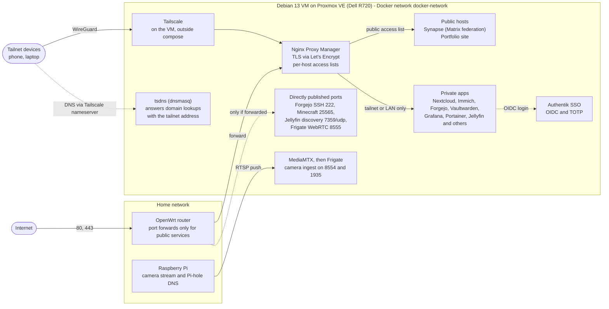
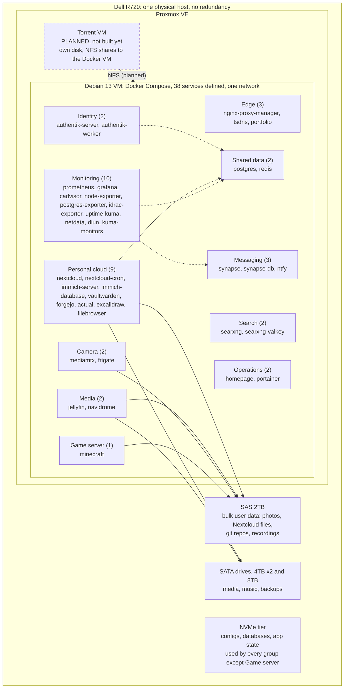

# Homelab architecture

[Back to the README](../README.md)

A single Dell PowerEdge R720 running Proxmox VE, with a Debian 13 VM hosting the Docker Compose stack. It is a personal homelab on one physical host with no redundancy. Diagrams are generated from `docker-compose.yml`; dashed boxes are planned and not built.

## 1. Access and network flow

- **Public path:** the internet reaches Nginx Proxy Manager only through router port forwards. Only the public hosts (Matrix federation and the portfolio site) are open to everyone.
- **Private path:** everything else is restricted by NPM access lists to the tailnet or the LAN. Tailscale provides remote access, and a containerized dnsmasq (`tsdns`) resolves the domain to the tailnet address so private hostnames work away from home.
- **Identity:** apps sign in through Authentik (OIDC) with TOTP.
- **Direct ports:** a few services publish their own ports (see the table). They are reachable from the LAN, and from the internet only if the router forwards them.

## 2. Service map

- **Dotted arrows** show `depends_on` links between groups. **Solid arrows** show volume mounts on the SAS and SATA tiers.
- Every group uses the NVMe tier for configs and databases except the game server, so those arrows are omitted.

## 3. Components

| Service | Role | Published ports | Storage | Depends on |
|---|---|---|---|---|
| `nginx-proxy-manager` | Reverse proxy, TLS, access lists | 80:80, 443:443, 81:81 | NVMe | - |
| `tsdns` | Split-horizon DNS (dnsmasq, host network) | host network | - | - |
| `portfolio` | Static portfolio site (nginx) | - | NVMe | - |
| `authentik-server` | SSO identity provider, web and API | - | NVMe | postgres |
| `authentik-worker` | SSO background worker | - | NVMe | postgres |
| `postgres` | Shared Postgres (authentik, nextcloud, forgejo) | - | NVMe | - |
| `redis` | Shared cache (Nextcloud, Immich) | - | NVMe | - |
| `nextcloud` | File sync | - | NVMe, SAS | postgres, redis |
| `nextcloud-cron` | Nextcloud background jobs | - | NVMe, SAS | nextcloud |
| `immich-server` | Photo backup | - | SAS | redis, immich-database |
| `immich-database` | Immich Postgres | - | NVMe | - |
| `vaultwarden` | Password manager | - | NVMe | - |
| `forgejo` | Git hosting | 222:22 | SAS | postgres |
| `actual` | Budgeting (OIDC login) | - | NVMe | - |
| `excalidraw` | Whiteboard | - | - | - |
| `filebrowser` | File manager | - | NVMe, SAS, SATA | - |
| `jellyfin` | Video streaming | 7359:7359/udp | NVMe, SAS, SATA | - |
| `navidrome` | Music streaming | - | NVMe, SAS | - |
| `synapse` | Matrix homeserver (federated) | - | NVMe | synapse-db |
| `synapse-db` | Synapse Postgres | - | NVMe | - |
| `ntfy` | Push notifications | - | NVMe | - |
| `searxng` | Metasearch | - | NVMe | searxng-valkey |
| `searxng-valkey` | SearXNG cache | - | NVMe | - |
| `mediamtx` | Camera stream relay (RTSP/HLS) | 8554:8554, 1935:1935 | - | - |
| `frigate` | Object detection and recording | 8555:8555/tcp, 8555:8555/udp | NVMe, SAS | mediamtx |
| `prometheus` | Metrics store (15d / 5GB retention) | - | NVMe | - |
| `grafana` | Dashboards (OIDC login) | - | NVMe | prometheus |
| `cadvisor` | Per-container metrics (privileged) | - | - | - |
| `node-exporter` | VM metrics | - | - | - |
| `postgres-exporter` | Postgres metrics | - | - | postgres |
| `idrac-exporter` | Server hardware metrics (iDRAC) | - | NVMe | - |
| `uptime-kuma` | Service monitoring and cert-expiry alerts | - | NVMe | - |
| `netdata` | Live host view (host network) | host network | NVMe, docker.sock | - |
| `diun` | Image update notices to ntfy | - | NVMe, docker.sock | ntfy |
| `kuma-monitors` | One-shot monitor provisioning (profile: tools) | - | - | - |
| `homepage` | Dashboard | - | NVMe, docker.sock | - |
| `portainer` | Container management | - | NVMe, docker.sock | - |
| `minecraft` | Minecraft server (Fabric) | 25565:25565 | SAS | - |

## 4. Outside the compose file

These pieces are part of the setup but are not defined in this repository: the Proxmox VE host, Tailscale (installed on the VM), the OpenWrt router and its port forwards, Pi-hole and the camera on the Raspberry Pi, the iDRAC, and the Nginx Proxy Manager host entries and access lists.

## 5. Planned, not built

A second VM for torrenting, with its own disk and NFS shares to the Docker VM. Intrusion prevention (CrowdSec/fail2ban) was evaluated for a later phase.
